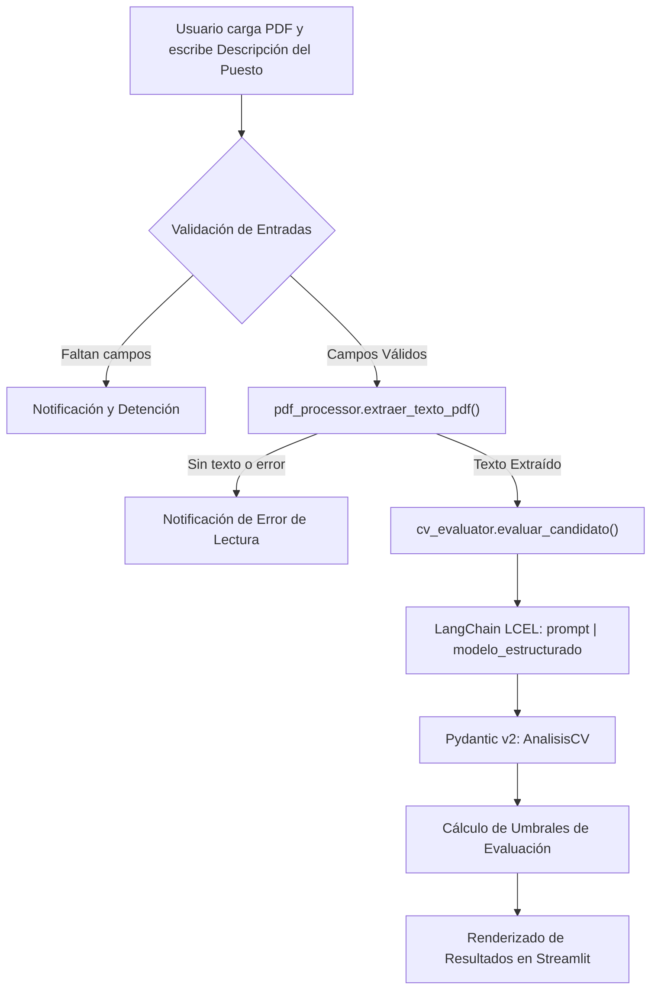

# Analizador de Currículums con IA

Aplicación desarrollada en Streamlit y LangChain que evalúa y contrasta un currículum vitae en formato PDF frente a la descripción de un puesto de trabajo. Extrae el texto digital del documento mediante PyPDF2, lo procesa con un modelo de lenguaje con salida estructurada Pydantic y presenta el perfil analizado con métricas y recomendaciones de contratación.

---

## 1. Arquitectura y Componentes del Sistema

El módulo se estructura conforme al patrón de separación de responsabilidades:

```
app/intermedio/cv_analyzer/
├── README.md               # Documentación técnica del módulo
├── app.py                  # Punto de entrada de Streamlit
├── models/
│   ├── __init__.py
│   └── cv_model.py         # Esquema Pydantic AnalisisCV
├── prompts/
│   ├── __init__.py
│   └── cv_prompts.py       # Plantilla ChatPromptTemplate y directivas de ponderación
├── services/
│   ├── __init__.py
│   ├── pdf_processor.py    # Extracción de texto con PyPDF2 y validación de buffers
│   └── cv_evaluator.py     # Configuración e invocación del modelo estructurado
└── ui/
    ├── __init__.py
    └── streamlit_ui.py     # Interfaz gráfica, umbrales y presentación
```

---

## 2. Flujo de Ejecución



---

## 3. Criterios de Evaluación y Ponderaciones

El prompt del sistema instruye al modelo de lenguaje a calcular de forma holística el campo `porcentaje_ajuste` (entre 0 y 100) respetando las siguientes ponderaciones:

| Criterio de Evaluación | Ponderación Solicitada |
| :--- | :--- |
| **Experiencia relevante** | 40 % |
| **Habilidades técnicas** | 35 % |
| **Formación y certificaciones** | 15 % |
| **Coherencia profesional** | 10 % |

> **Nota:** La puntuación la computa el modelo semánticamente a partir de las directivas. El código no aplica fórmulas aritméticas externas ni desglosa subtotales.

---

## 4. Doble Escala de Umbrales

La interfaz aplica dos clasificaciones independientes derivadas del porcentaje obtenido:

### Evaluación Principal
| Rango de Porcentaje | Clasificación |
| :--- | :--- |
| 80 – 100 % | **Excelente** |
| 60 – 79 % | **Bueno** |
| 40 – 59 % | **Regular** |
| 0 – 39 % | **Bajo** |

### Recomendación Final
| Rango de Porcentaje | Decisión de Contratación |
| :--- | :--- |
| 70 – 100 % | **Candidato recomendado** |
| 50 – 69 % | **Candidato con potencial** |
| 0 – 49 % | **Candidato no recomendado** |

*Ejemplo:* Un candidato con un 65 % de ajuste se clasifica como **Bueno** en la evaluación principal y como **Candidato con potencial** en la recomendación final.

---

## 5. Esquema Pydantic (`AnalisisCV`)

Todos los campos del modelo son obligatorios:

```python
class AnalisisCV(BaseModel):
    nombre_candidato: str
    experiencia_años: int
    habilidades_clave: list[str]
    education: str
    experiencia_relevante: str
    fortalezas: list[str]
    areas_mejora: list[str]
    porcentaje_ajuste: int  # Con restricción ge=0, le=100
```

---

## 6. Instrucciones de Ejecución

### Opción A: Ejecución Local

1. Desde la raíz del repositorio, activar el entorno virtual e instalar dependencias:
   ```bash
   pip install -r requirements.txt
   ```

2. Definir la clave de API de OpenAI:
   * **PowerShell (Windows):**
     ```powershell
     $env:OPENAI_API_KEY = "tu_clave_de_openai"
     ```
   * **Bash (Linux/macOS):**
     ```bash
     export OPENAI_API_KEY="tu_clave_de_openai"
     ```

3. Posicionarse en el directorio del módulo e iniciar Streamlit:
   ```bash
   cd app/intermedio/cv_analyzer
   python -m streamlit run app.py --server.port=8501
   ```
   Abrir `http://localhost:8501` en el navegador.

---

### Opción B: Ejecución con Docker

#### Contenedor Independiente
Desde la raíz del repositorio (`docker-base`):
```bash
docker build -t cv-analyzer .
docker run --rm -p 8501:8501 \
  -e OPENAI_API_KEY \
  -w /app/app/intermedio/cv_analyzer \
  cv-analyzer \
  python -m streamlit run app.py --server.address=0.0.0.0 --server.port=8501
```

#### Entorno Docker Compose Compartido
```bash
docker compose up -d --build
docker compose exec -w /app/app/intermedio/cv_analyzer app \
  python -m streamlit run app.py --server.address=0.0.0.0 --server.port=8501
```

---

## 7. Pruebas Automatizadas

El proyecto incluye una suite de pruebas con Pytest para validar el comportamiento sin consumo de tokens externos:
```bash
pytest app/intermedio/cv_analyzer/tests/ -v
```

---

## 8. Correcciones y Mejoras Implementadas

* **Corrección del bloque de contingencia:** Se resolvió el fallo en el que se instanciaba `AnalisisCV` con los atributos erróneos `fotalezas` y `porcetaje_ajuste`. Se utilizan los nombres validados `fortalezas` y `porcentaje_ajuste`.
* **Modo Demostración / Offline:** Permite realizar pruebas deterministas del flujo de interfaz y renderizado cuando no se dispone de cuota activa en la API.
* **Soporte Dual:** Compatibilidad tanto con `gpt-4o-mini` de OpenAI como con `gemini-3.5-flash` de Google.
